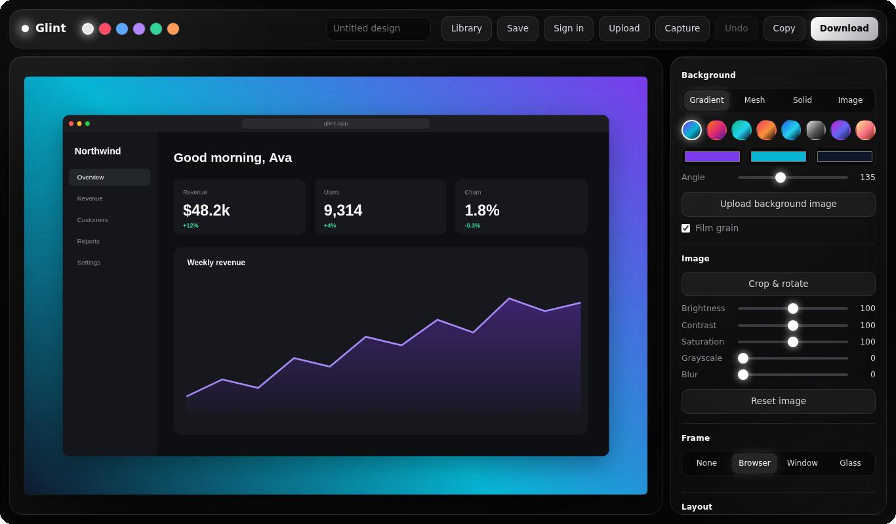
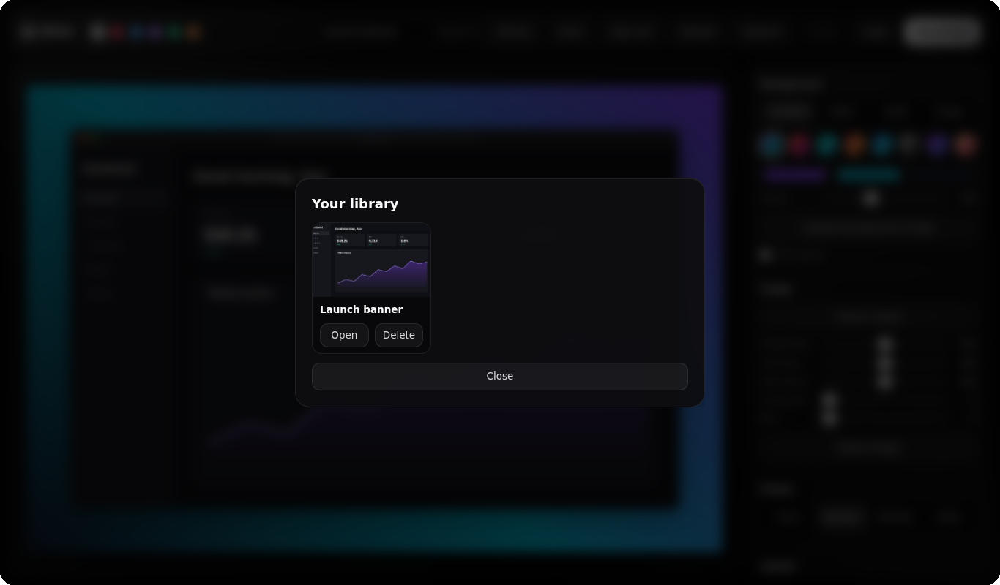

# Glint

**Turn screenshots into beautiful visuals.**

Drop in a screenshot, pick a background and frame, annotate it, and download a polished image. Editing happens in your browser. Create an account to save designs to a library and open them on any device.



## Features

- **Backgrounds:** gradient, mesh, solid colour or your own image, with film grain.
- **Frames:** browser, window or glass.
- **Layout:** padding, corner radius, shadow, zoom, rotation and ready-made aspect ratios (Instagram, X, YouTube, Story, OpenGraph).
- **Image tools:** crop, rotate and flip, plus brightness, contrast, saturation, grayscale and blur.
- **Annotations:** text, arrows, boxes, step numbers and a redact tool that pixelates what is underneath.
- **Export:** PNG, JPG or WebP at 1x to 4x, or copy straight to the clipboard.
- **Capture:** paste with Ctrl+V, drag and drop, or capture your screen.
- **Themes:** six colour themes.
- **Accounts and library:** register, sign in, save up to 30 designs and reopen them later.



## Project structure

```
glint/
  client/             static front end, no build step
    index.html        the whole app
    config.js         set the API address here
  server/             accounts and library API
    server.js
    package.json
    .env.example      copy to .env
  docs/screenshots/
  README.md
  LICENSE
```

## Run it locally

You need [Node.js](https://nodejs.org) 18 or newer.

```bash
cd server
npm start
```

Open `http://localhost:3000`. The server serves the client too, so `config.js` can stay empty. With no `MONGODB_URI` set, accounts and designs are saved in `server/data/glint.json`. That is for development only.

### Use MongoDB

```bash
cd server
cp .env.example .env     # then fill in MONGODB_URI and JWT_SECRET
npm install
npm start
```

The console should say `database: MongoDB`.

## Settings (environment variables)

| Name | Required | What it is |
| --- | --- | --- |
| `MONGODB_URI` | yes, for real use | MongoDB connection string. Put the value only, with no `MONGODB_URI=` inside it |
| `JWT_SECRET` | yes, in production | Long random string that signs sign-in tokens. Generate one with `node -e "console.log(require('crypto').randomBytes(32).toString('hex'))"` |
| `MONGODB_DB` | no | Database name, defaults to `glint` |
| `CLIENT_ORIGIN` | no | Your client's address, for example `https://glint.vercel.app`, so only your site can call the API |
| `PORT` | no | Defaults to 3000 |

If `JWT_SECRET` is missing the server makes a temporary one, and everyone is signed out whenever it restarts.

## Deploy: client on Vercel, server on Render

**1. Server on Render**
1. New, then Web Service, and pick your GitHub repository.
2. Root Directory: `server`. Build Command: `npm install`. Start Command: `npm start`.
3. Add the environment variables above (at least `MONGODB_URI` and `JWT_SECRET`).
4. In MongoDB Atlas, open Network Access and allow `0.0.0.0/0`.
5. Deploy, then open `https://YOUR-SERVICE.onrender.com/api/health`. It should show `"db":"MongoDB"`.

**2. Client on Vercel**
1. In `client/config.js`, set `window.GLINT_API = 'https://YOUR-SERVICE.onrender.com';` with no slash at the end. Commit it.
2. Import the repository into Vercel. Root Directory: `client`. Framework: Other. Leave the build settings empty and add no environment variables.
3. Deploy.
4. Back on Render, set `CLIENT_ORIGIN` to your Vercel address and redeploy.

A free Render service sleeps when idle, so the first sign-in after a quiet period can take 30 to 60 seconds.

## API

All routes are under `/api`. Routes marked with a lock need an `Authorization: Bearer <token>` header.

| Method | Path | What it does |
| --- | --- | --- |
| `GET` | `/health` | Status and database name |
| `POST` | `/auth/register` | Create an account, returns a token |
| `POST` | `/auth/login` | Sign in, returns a token |
| `GET` | `/projects` (lock) | List your designs |
| `POST` | `/projects` (lock) | Save a design (up to 30 per account) |
| `GET` `PUT` `DELETE` | `/projects/:id` (lock) | Open, update or delete a design |

Passwords are hashed with scrypt and never stored in plain text. Tokens are signed and last 7 days. Sign-in attempts are limited to 20 per 15 minutes for each address. Each design is only visible to the account that saved it.

## Notes

- Fonts load from Google Fonts. Without a connection the app falls back to system fonts.
- Screen capture and clipboard copy need a modern browser and a secure (https) page.
- Motion respects the `prefers-reduced-motion` setting.

## Tech

Plain HTML, CSS and JavaScript on the client, drawn with the Canvas API. The server is Node with no framework. The only npm dependency is the `mongodb` driver.

## License

MIT. See [LICENSE](LICENSE).
